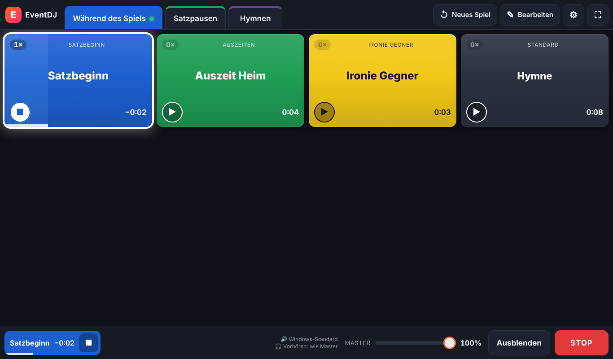
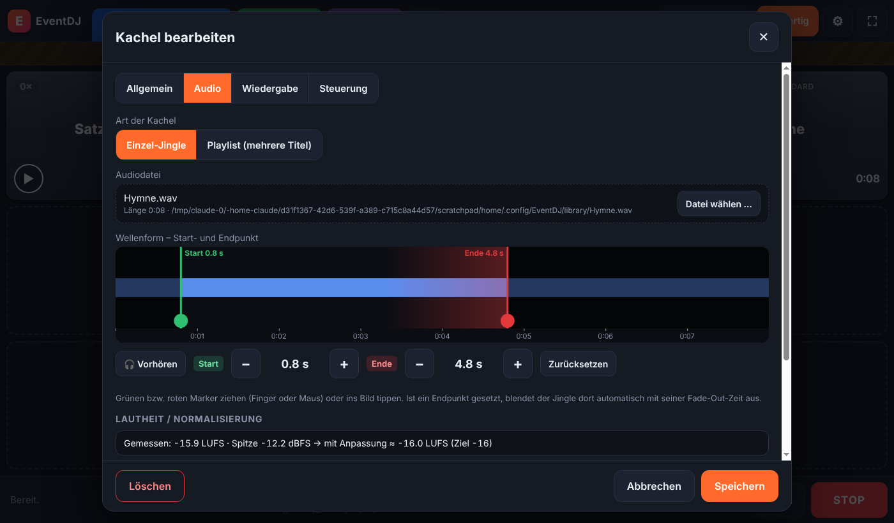
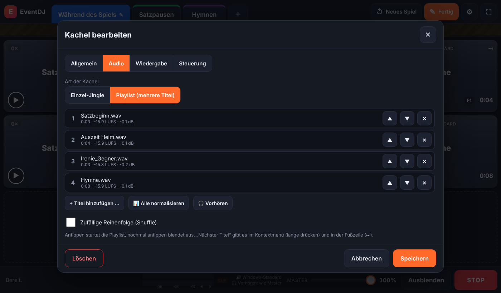
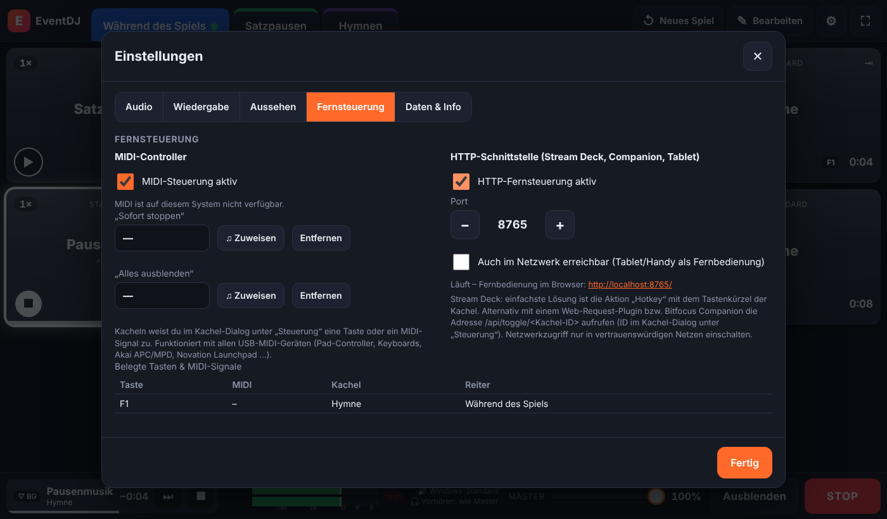
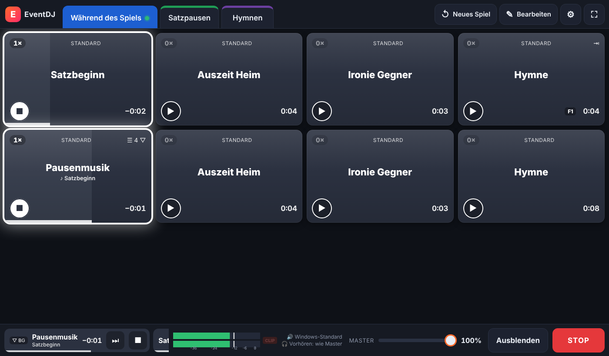

# EventDJ

**Jingle-Player für Event-DJs unter Windows** – gebaut für Hallensport (z. B. Volleyball), Galopprenntage, Stadtfeste und alle Veranstaltungen, bei denen es auf den richtigen Sound im richtigen Moment ankommt. Bedienbar per **Touchscreen und Maus**.



## Funktionen

| Bereich | Was EventDJ kann |
|---|---|
| **Reiter** | Beliebig viele Reiter, frei benennbar und farbig (z. B. *Während des Spiels*, *Satzpausen*, *Hymnen*). Reihenfolge per Ziehen oder Pfeiltasten änderbar. |
| **Kachel-Matrix** | Pro Reiter frei wählbar (1–12 Spalten × 1–12 Zeilen). Die Kacheln füllen den Bildschirm automatisch aus. |
| **Jingles** | MP3, WAV, OGG, FLAC, M4A/AAC, OPUS, WEBM – per Drag & Drop aus dem Explorer oder über den Datei-Dialog. |
| **Fades** | Kurzes Fade-In beim Start, Fade-Out beim Stoppen. Dauer global und pro Kachel einstellbar. Neuer Jingle blendet den laufenden automatisch aus (Crossfade) – oder alles gleichzeitig. |
| **Kacheln** | Titel, Untertitel, Abspielzähler, Play-Button, Restzeit, Fortschrittsbalken. Die ganze Kachel ist anklickbar. |
| **Eigenschaften (Stile)** | Vorlagen mit Hintergrund-/Schriftfarbe, Schriftgröße, Fettdruck – z. B. *Satzbeginn* blau, *Auszeiten* grün, *Ironie Gegner* gelb. Pro Kachel überschreibbar. |
| **Zähler** | Wie oft wurde ein Jingle gespielt? Mit **„Neues Spiel“** alle Zähler auf einen Schlag zurücksetzen (oder nur einen Reiter / eine Kachel). |
| **Audio-Ausgang** | **Master** frei wählbar: Lautsprecher/Klinke, USB-Soundkarte, HDMI, Bluetooth … Dazu ein separater **Vorhör-Ausgang** (Kopfhörer) zum Reinhören, ohne dass das Publikum etwas hört. |
| **Sicherheit im Live-Betrieb** | Bearbeitungsmodus getrennt vom Live-Modus, großer STOP-Button, „Ausblenden“ für alles, Schutz vor versehentlichem Neuladen, automatische Speicherung mit Backup. |
| **Sets** | Komplettes Set (Reiter, Kacheln, Stile **inkl. Audiodateien**) als `.edjset` exportieren und auf einem anderen PC importieren. |
| **Wellenform-Editor** | Start- und Endpunkt per Finger oder Maus direkt in der Wellenform setzen. Am Endpunkt blendet der Jingle automatisch aus; Schleifen laufen zwischen Start und Ende. |
| **Lautheit** | Automatische Messung (LUFS nach ITU-R BS.1770) und Angleichung aller Jingles auf eine Ziel-Lautheit – kein Jingle fällt mehr aus der Reihe. Pegelanzeige (VU-Meter) mit Clip-Warnung. |
| **Playlists & Ducking** | Kacheln mit mehreren Titeln (nacheinander oder zufällig, wiederholbar). Als *Hintergrundmusik* laufen sie unter Jingles weiter und werden währenddessen automatisch abgesenkt. |
| **Fernsteuerung** | Tastenkürzel pro Kachel, **MIDI-Controller** (Pads, Tasten, Regler) mit Lernfunktion, **HTTP-Schnittstelle** für Elgato Stream Deck / Bitfocus Companion und eine Browser-Fernbedienung fürs Tablet/Handy. |

## Download & Installation

1. Unter **[Releases](https://github.com/stadtkindd/EventDJsw/releases)** die neueste Version laden:
   - `EventDJ-Setup-x.y.z.exe` – normale Installation (Startmenü + Desktop-Verknüpfung)
   - `EventDJ-Portable-x.y.z.exe` – ohne Installation, z. B. vom USB-Stick. Daten liegen im Ordner `EventDJ-Daten` neben der EXE.
2. Ohne Release: Unter **Actions → Windows-Build → letzter Lauf → Artifacts** liegen die EXE-Dateien jedes Builds.

> Windows SmartScreen kann beim ersten Start warnen, weil die EXE nicht signiert ist: *Weitere Informationen → Trotzdem ausführen*.

## Schnellstart

1. EventDJ starten → oben rechts **✎ Bearbeiten**.
2. Leeres Feld antippen oder Audiodateien aus dem Explorer auf die Kacheln ziehen.
3. Kachel antippen → Titel, **Eigenschaft** (Stil), Fades, Lautstärke einstellen → **Speichern**.
4. Aktiven Reiter antippen → Name, Farbe und **Matrix** (Spalten × Zeilen) festlegen.
5. **⚙ Einstellungen → Audio-Ausgabe**: Master-Ausgang (z. B. Mischpult/Bluetooth-Box) und Vorhör-Ausgang (Kopfhörer) wählen, mit **♪ Test** prüfen.
6. **Fertig** → Live-Betrieb. Kachel antippen = Abspielen, nochmal antippen = Ausblenden.
7. Vor jedem Spiel/Event: **↺ Neues Spiel** setzt alle Zähler zurück.

Ausführliche Anleitung: **[docs/BEDIENUNGSANLEITUNG.md](docs/BEDIENUNGSANLEITUNG.md)**

| Wellenform & Lautheit | Playlist mit Ducking |
|---|---|
|  |  |
| **Fernsteuerung (MIDI, HTTP, Stream Deck)** | **Hintergrundmusik wird unter dem Jingle abgesenkt** |
|  |  |

## Bedienung im Überblick

| Aktion | Touch | Maus / Tastatur |
|---|---|---|
| Jingle abspielen / ausblenden | Kachel antippen | Klick |
| Kontextmenü (Vorhören, Bearbeiten, Verschieben, Zähler, Löschen) | lange drücken | Rechtsklick |
| Alles ausblenden | „Ausblenden“ | `Esc` |
| Sofort alles stoppen | „STOP“ | `Umschalt+Esc` |
| Reiter wechseln | Reiter antippen | `Strg+1` … `Strg+9` |
| Jingle per Tastenkürzel / MIDI | – | eigene Taste (z. B. `F1`) bzw. Pad am Controller |
| Playlist: nächster Titel | lange drücken → *Nächster Titel* oder ⏭ in der Fußzeile | Rechtsklick |
| Bearbeitungsmodus | ✎ | `Strg+E` |
| Vollbild | ⛶ | `F11` |

## Für Entwickler

Technik: [Electron](https://www.electronjs.org/) (Chromium + Node.js), reines HTML/CSS/JavaScript ohne Framework.

```bash
git clone https://github.com/stadtkindd/EventDJsw.git
cd EventDJsw
npm install
npm start          # App starten
npm run dev        # mit DevTools (F12)
npm test           # Tests des Datenmodells
npm run dist       # Windows-Installer + Portable-EXE nach dist/ (auf Windows ausführen)
```

Aufbau, Datenformat und Audio-Engine: **[docs/ENTWICKLUNG.md](docs/ENTWICKLUNG.md)**

Neues Release: Version in `package.json` erhöhen (z. B. `npm version patch --no-git-tag-version`) und auf `main` pushen – der Workflow baut die EXE-Dateien und legt automatisch das Release `v<version>` mit beiden Dateien an.

## Lizenz

MIT – siehe [LICENSE](LICENSE).
